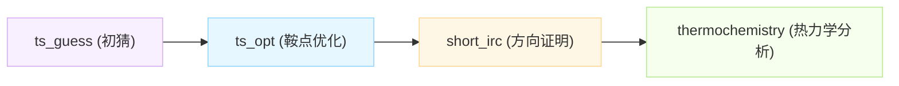

# AGENTS.md — Cloudra 项目开发者与 AI 协作指南

> **一句话定位**：Cloudra 是一个面向化学反应机理自主探索的多 Agent 系统。
> 本文件是仓库的**人话版全景地图与工程交规**，旨在让新开发者和 AI 助手能瞬间看懂架构、少踩深坑。
> 架构设计背景请参考 [README.md](file:///Users/cloudrayyy/Desktop/Desktop_Archive/Projects/Cloudra-mechanism-agent-master/README.md)；本文档是**地图而非实现手册**，各模块细节以代码为准。

---

## 当前首要目标：做减法

Cloudra 当前优先减少接口、字段、提示词和维护负担。改动应先考虑删除重复状态、无用分支和要求模型手工完成的机械步骤；不要用新增配置、抽象层或更多说明掩盖复杂度。

- **内部参数严禁要求 LLM 填写**：版本号、`expected_revision`、哈希/摘要、幂等键、租约、审查指纹等由程序生成、绑定和校验。模型只声明研究意图、必要的科学输入、具体文件和理由；不可把内部并发或溯源协议推给模型维护。
- **模型填错时先追接口根因**：检查字段是否必要、默认值是否一致、编号和坐标是否关联、错误是否准确指出修复对象、恢复信息是否真正传递给下一环节。不要停在“模型没按说明填”的归因上。
- **删到真实调用链上**：删除公开字段时同步删除相关提示和调用要求，内部必要的证据溯源与并发保护仍由程序承担；不留兼容字段或空壳接口。科学判断和证据验收标准必须保留，遵守下面的科学决策红线。

---

## 🛑 开发与协作 7 大铁律（绝不能踩的红线）

无论你是人类开发者还是编写代码的 AI Agent，修改代码时必须死守以下底线：

1. **禁止过度工程（YAGNI）**：
   只做当前被明确要求的事。严禁脑补“未来可能会用到”的中间抽象层、复杂配置项、通用插件点或冗余分支。每写一个新的公开接口或抽象类，先问自己：“**现在有谁在调它？**” 答不上来就不许加。
2. **化学与科学决策严禁擅自拍板**：
   涉及化学科学层面的设计（包括但不限于：反应能垒合格线、量子化学方法/泛函/基组选择、构象打分阈值、Benchmark 评分权重、不可达判定标准等），**必须向人类用户询问并确认，禁止 Agent 自行决定**。
3. **校验路径绝对禁止使用正则表达式 (`re`)**：
   `re` 模块唯一允许出现的场景是**解析量子化学软件（如 ORCA、Gaussian）的原始文本输出日志**。
   所有针对 Agent 响应、工具入参、结构化数据、状态转换的校验，**一律使用 Pydantic、`json.loads`、显式 Token 匹配或枚举比对**，发现问题直接 Fail-Loud（报错终止），绝不许用正则“模糊猜测匹配”！
4. **异步事件循环 (`async`) 严禁同步阻塞**：
   在 `async` 函数体内，**绝对禁止**直接执行同步的 SQLite 查询、`time.sleep()`、`subprocess.run()` 或同步网络请求！凡是可能阻塞的操作，必须封装至 `asyncio.to_thread` 或改用异步库。常驻守护测试：`tests/test_no_sync_on_loop.py`。
5. **计算进程绝对保活，严禁随意 Kill**：
   调度器（Scheduler）和任务守卫（Guard）在任何异常或失败路径下，**绝不能擅自杀掉正在跑的量子化学计算进程**。
   - 作业取消只能通过数据库账本设置 `cancel_requested` 标志，由远端轮询收尾；
   - 进程存活与否**唯一认准文件排他锁**（见 `infra/flocks.py`），持有锁的作业绝对不能被标记为 failed。
6. **架构级根治，不留历史包袱**：
   项目目前处于活跃演进期，**不考虑向下兼容**。遇到架构坏味道请彻底重构根治——不留 legacy 回退垫片（shim）、不加冗余兼容开关、不保留死代码。修复 Bug 必须附带能精准重现该问题的单测。
7. **本地测试只跑改动模块，不跑全套**：
   全套测试非常耗时，交由 CI 运行。本地开发规范流程：
   `compileall`（语法检查） → `ruff`（代码规范） → 运行相关模块测试（按前缀选跑）。除非用户明确要求，否则不要在本地运行 `pytest tests/` 全集。

---

## 🛠️ 常用开发命令速查 (Cheat Sheet)

```bash
# 1. 语法检查与代码风格检查（改完代码必跑）
uv run python -m compileall -q cloudra tests
uv run ruff check cloudra tests

# 2. 聚焦运行测试（按改动的子系统挑选，只跑相关单测）
uv run pytest -q tests/test_dag_engine.py       # DAG 引擎单测
uv run pytest -q tests/test_runtime_v2_*        # Agent 新内核单测
uv run pytest -q tests/test_compute*            # 计算执行与调度单测

# 3. 验收全套测试（仅在用户明确要求或发版前跑；注意：千万不要管道给 tail/grep，会掩盖退出码！）
uv run pytest -q tests/ > /tmp/pytest.log 2>&1; echo EXIT=$?

# 4. 服务启停与调度器
cloudra                                         # 构建前端并启动 Web 服务（后台自动拉起 scheduler 守护）
cloudra web --host 0.0.0.0 --port 8000          # 绑定公网/局域网（注意：非 127.0.0.1 时绝对禁止关 token）
cloudra scheduler                               # 在前台运行计算调度守护进程（依赖单实例 flock 锁）
cloudra stop                                    # 显式安全停止所有服务（安全终止，不误杀 QM 计算）

# 5. LLM 遥测数据导出与观测
cloudra stats tokens|cache|agents|export <id> -o <path>

# 6. JS 宿主环境测试
npm --prefix cloudra/runtime_v2/js_host test    # 运行 QuickJS 宿主测试
```

> [!IMPORTANT]
> **平台支持政策**：本项目为 **纯 POSIX 目标（Linux / macOS）**，要求 Python >= 3.11。
> 主分支（`master`）不接受任何 Windows 兼容补丁。Windows 专属代码统一在 `windows` 分支维护，相关 PR 请以 `windows` 分支为 base。

---

## 🗺️ 仓库架构与模块“人话”地图

Cloudra 的代码主体在 `cloudra/` 目录下。为了防止迷路，以下是各模块的人话解读：

```
cloudra/
├── runtime_v2/    # 【大脑与中枢】新一代事件驱动 Agent 内核，模型推理循环的唯一实现
├── dag/           # 【监理看板】机理研究的 DAG（有向无环图）编排与交付物审核体系
├── tools/         # 【工具箱】提供给 Agent 调用的化学、量子化学、文件及搜索工具
├── scheduler/     # 【调度中心】量子化学计算任务的分发、排队与多节点配额管理
├── runtime/       # 【运行时守卫】计算任务的执行监视器（Monitor/Guard）及 Prompt 拼装
├── services/      # 【控制面 API】FastAPI 路由、多节点注册与关停管理
├── persistence/   # 【持久化层】统一路径生成器（paths.py）与数据库管理
├── knowledge/     # 【知识库 Chem-KB】化学反应与过渡态知识检索（严格只读）
├── benchmark/     # 【评测考场】机理探索能力的独立打分体系
├── infra/         # 【水电气底座】配置中心、进程锁（flock）、SSH/Slurm 远端通信
└── base/          # 【基类与协议】技能加载器、人机审批钩子、角色身份映射
```

### 1. `runtime_v2/`：Agent 智能内核
- **推理循环**：基于事件驱动（Event-driven）。模型做出决策 → 通过 `CommandBus` 派发命令（四步：决定 → 先存盘后生效 → 执行副作用） → `apply_event` 更新状态。
- **角色体系**：所有 Agent 身份在 `runtime_v2/roles.py` 的 `RoleProfile` 中单点定义，废弃了历史的继承类体系。
- **督导机制 (`supervision.py`)**：Supervisor（导师）Agent 运行时，它唯一的任务来源是读取 DAG 图存储中的待办，不自行瞎猜。
- **沙箱隔离 (`js_runtime.py`)**：通过 QuickJS-WASM 运行轻量代码逻辑。如需终止，只杀 JS 进程，绝不触碰底层的量子化学计算！
- **Policy 过滤链**：内置 8 个 PolicyStage（例如权限拦截、物理思维引导 `physical-thinking`、过度调用拦截、上下文无损折叠压缩等）。

### 2. `dag/`：DAG 引导与证据交付（核心业务）
- **核心思想**：反应机理是一个有向无环图。模型“说自己完成了”是无效的，必须把**经受住频率分析和路径检验的计算结果**绑定到图的节点和边上。
- **数据流向**：`models.py`（图数据结构） → `store.py`（持久存储，权威事实源） → `engine.py`（事务变更引擎，删边/删点必须给合理理由） → `controller.py`（门面控制器）。
- **驻点校验三态**：
  1. `未计算`；
  2. `已完成计算但未确证`；
  3. `已验证为极小值点`（`verified=True`，必须有 0 虚频分析支撑）。**“没做频率分析”绝不等同于“验证成功”！**

### 3. `tools/`：化学与系统工具箱
- **注册单源**：所有工具统一在 `registry.py` 注册，并根据角色白名单（`role_allowlist`）控制暴露。
- **物理判据绝不造假**：
  - `structure_builder.py`：分片建模。“几何优化 exit 0”不代表化学结构可用！
  - `crest_runner.py` / `xtb_path_runner.py`：构象与反应路径扫描。进程没有崩溃不代表找到了过渡态，必须依据确凿的能量和结构特征判断。
  - `ts_process.py` / `irc_path.py` / `irc_evidence.py`：过渡态与 IRC 方向证明组装。
  - `Chemtool/mechanism_predict.py`：FlowER 机器学习机理预测**仅供生成假设，绝不能充当计算证据**。
- **编号规范**：Gaussian 默认从 1 开始编号（1-based），ORCA 从 0 开始编号（0-based），结构工具统一 1-based，内部逻辑精准转换，不准猜。

### 4. `scheduler/` & `runtime/`：量子化学计算监视与调度
- **计算调度 (`scheduler/`)**：
  - 与 Web API 完全解耦，单实例运行，通过 `compute.db` 驱动。
  - **容量池管理**：每个计算节点声明固定并发额度。如果一个作业指定了在集群 A 跑，哪怕集群 A 塞车、机器 B 空闲，也**绝对不允许自动转投机器 B**！
- **任务守卫 (`runtime/monitor.py`)**：
  - 启动 `calculator.sh` 并在后台守卫。
  - **计算成败标准**：以量子化学软件原生输出文件末尾的**官方正常终止标记（如 ORCA TERMINATED NORMALLY）**为准。`cclib` 仅用来抓取几何与能量数值，绝不能凭 cclib 解析成功就认定计算通过。

### 5. `persistence/`：持久化与数据目录单源
- `paths.py`：**项目所有数据目录的唯一权威路径表**。需要找临时目录、计算输出、数据库文件？统统从 `paths.py` 取，严禁自己拼接路径！
- `database.py`：维护会话库（`ConversationDB`）与中央计算账本库（`ComputeDB`，即 `data_dir/compute.db`）。

### 6. `infra/`：基础设施底座
- `flocks.py`：**判断底层进程生死与互斥的唯一手段**（基于 Linux/macOS 文件排他锁）。
- `config.py`：YAML 配置的唯一事实源，修改配置必须走 `mutate_config`。
- `ssh_transport.py`：集群 SSH 提交与 Rsync 文件传输，同步阻塞调用一律使用 `asyncio.to_thread` 转到子线程。

---

## 📁 顶层与辅助目录导航

- `kg_data/`：知识图谱 CSV 数据（`cloudra knowledge import` 的输入）。
- `ideapool/reaction_candidates/`：存量 benchmark 题源 Markdown；新候选见 `gold_compute/README.md`。
- `vector_store/`：知识卡片 BGE-M3 向量数据（微服务运行在外部 `.venv-trans`）。
- `gold_compute/`：Gold 基准真值战役目录，主线是边选反应边填自算 Gold 数据；归档交接见 `gold_compute/archive/`。
- `paper/`：保存研究论文正文；`paper/literature/` 收拢文献原件与下载缓存；阶段性综述在 `paper/archive/`。
- `scripts/`：脚本目录（详见 `scripts/README.md` 索引）；申报文档编辑脚本在 `scripts/application_docs/`。
- `docs/`：项目文档与技术设计 Spec；阶段性交付文档按 `docs/README.md` 归档到 `docs/archive/`；原图资源位于 `docs/assets/`。
- `build/`、`.worktrees/`、`cloudra.egg-info/`：构建与分发副产物，严禁手改。软著清单由 `scripts/gen_copyright_source.py` 自动生成。

---

## 🔬 DAG 机理图：反应步骤如何才算交付成功？

在 DAG 编排模式下，Agent 需要提交一个反应机理图。对于一条反应步骤（即连接反应物和产物的过渡态边），如何才算通过审查？

必须严格按阶段推进并绑定证据：



1. **`ts_guess`（过渡态初猜）**：建议性阶段，生成合理的过渡态结构猜测。
2. **`ts_opt`（鞍点优化）**：必须正常收敛，且经频率分析确证为**一阶鞍点（有且仅有 1 个虚频）**。
3. **`short_irc`（路径方向区间证明）**：
   - 证明虚频振动的两端确实一边倒向反应物、一边倒向产物。
   - **无需整条 IRC 必须完全收敛到底**，但两端的几何构型必须位于过渡态与两端极小值点之间，方向区间吻合。
4. **`thermochemistry`（热力学校正）**：提取自由能与焓变，计算活化能垒 $\Delta G^\ddagger$。

> [!NOTE]
> **关于不可达反应（Impossible 题目）**：
> 如果某个反应通路在物理化学上不可行，Agent 应当在机理图上如实提交该步骤，并将其标记为 `accessible=false`。在 Benchmark 中，正确证明并标记“不可达”同样能拿满分。**切勿企图用不交付或拒答来逃避计算！**

---

## 🎯 Benchmark 评分体系：分数是怎么算出来的？

Benchmark 评测完全独立于聊天上下文，**只看交付文件（机理图 JSON + 量化计算日志）**，大模型聊天里的自然语言一概不认！

### 1. 综合得分公式（2026-09-25 用户裁决定版）

$$\text{Composite Score} = 0.1 \times \text{图结构分 (Graph)} + 0.3 \times \text{自洽性 (Self-consistency)} + 0.6 \times \text{准确度 (Accuracy)}$$

*为什么图结构只占 10%？因为只要反应机理不正确，在 Accuracy（准确度）层就会受到毁灭性扣分，因此图结构不应虚高。*

### 2. 三大评分支柱

| 评分项 | 权重 | 判定规则 | 人话解释 |
| :--- | :---: | :--- | :--- |
| **图结构相似度 (Graph)** | **10%** | 子图同构与覆盖率判定。交付图中多出的无关边不扣分，但关键边缺失或 `accessible` 状态颠倒会重罚。 | “你找没找到论文里认定的关键机理主干？” |
| **物理自洽性 (Self-consistency)** | **30%** | **全有或全无（布尔值 1 或 0）**。所有驻点必须是 0 虚频，所有过渡态必须是 1 虚频且通过短 IRC 方向区间证明。 | “你算出来的每个分子结构在物理上站得住脚吗？有没有拿局部极大值冒充基态？” |
| **能垒准确度 (Accuracy)** | **60%** | 从 ORCA/Gaussian 真实日志中提取活化能垒，与黄金标准（Gold）比对。按高斯容差打分。 | “算出来的能垒和标准答案差多少 kcal/mol？” |

### 3. 两大致命惩罚规则（防作弊天网）

- **金标准边自洽回捞 (Gold-edge Clawback)**：
  如果 Agent 声称找到了金标准（Gold）里的某条关键反应步骤，但在自洽性检查中发现该步骤**虚频不对或 IRC 跑偏**，系统不仅在自洽性层给 0 分，还会**将该步骤从图结构分中强行剔除、倒扣图分**！*（原则：关键金标准边上胡说八道，惩罚远重于额外探索边）*
- **造假 / 数据不一致 Fail-Loud 短路**：
  若 Agent 在机理图声明的能垒值与绑定的真实计算日志对不上、或者凭空捏造数据，**评测立即触发短路熔断：自洽性和准确度直接归零，最终得分仅保留 $0.1 \times \text{图分}$！**

---

## 🧪 测试与开发规范 (tests/)

1. **测试文件分组规则**：
   - `test_dag_*`：DAG 编排、存储与变更引擎测试。
   - `test_runtime_v2_*`：Agent 内核、调度驱动与策略管道测试。
   - `test_compute*` / `test_slurm*`：底层计算与集群作业测试。
   - 其他：各类化学工具的独立单元测试。
2. **环境隔离保护**：
   `tests/conftest.py` 会自动将所有测试的 `data_dir` 重定向至独立的临时目录（`tmp_path`），**绝不允许在测试代码里硬编码指向真实的数据目录**！
3. **环境自适应跳过**：
   测试环境若缺少某些可选二进制程序（如未安装 `xtb`、`crest`、无 GPU 或非 POSIX 平台），测试必须**通过探针自动跳过 (`pytest.skip`)**，严禁因为本机环境没装外部软件而硬断言报错。
4. **场景回归测试 (`tests/agent_scenarios.py`)**：
   用于测试复杂 Agent 交互的自动化 Harness。
   - 内置 `ScriptedProvider`，**零真实 API Key 即可运行**；
   - 断言**只检查事件触发序列、状态机跃迁、字段持久化**，**绝不断言大模型回复的具体自然语言措辞**！
   - 凡是修复了“Agent 逻辑死锁或故障”的代码，必须在此补充一个回归场景。

---

## 🔬 附录：实验性构象搜索与约束优化模块

位于 `tools/core/conformer_*` 与 `constrained_optimization.py`：
- **构象归档**：构象生成与优化记录在 `conformer_catalog.py` 中，支持不可变追溯与区域快照（Regions）；
- **受约束几何优化**：基于笛卡尔坐标的 RFO/KKT 算法，带原子间距窗口；
- **Hessian 铁律**：优化的初始 Hessian 必须来自相同理论级别的实际计算产物，**严禁把位移末帧当作中心导数**；
- **资格验证与收敛**：数值收敛只代表几何算法收敛，化学意义上的科学有效性由后续流程独立判定。
