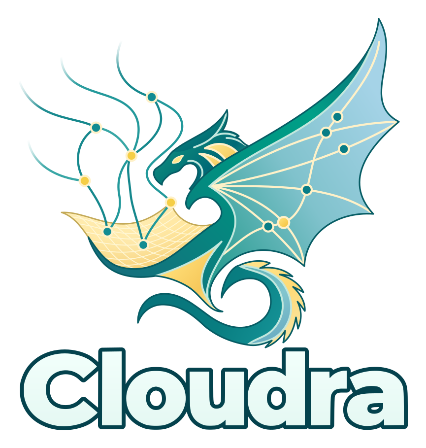

# Cloudra

<p align="center">
  
</p>

[](https://github.com/yyywaa/Cloudra-mechanism-agent/actions/workflows/ci.yml)
[](pyproject.toml)
[](LICENSE)

[中文](README_CN.md) · [Documentation](docs/README_EN.md) · [Paper & data](docs/RESEARCH_DATA.md) · [Contributing](CONTRIBUTING.md)

Meet Cloudra, an agent for theoretical and experimental chemists.

The previous version focused on **computational exploration of organic small-molecule reaction mechanisms**.

We will continue maintaining Cloudra, improving agent performance and exploring support for periodic systems, molecular dynamics and other widely needed applications. Our goal is a general-purpose chemistry agent, and we are working toward it.

The project is currently at the manuscript submission stage.

## What you can do

Cloudra currently provides a web UI. Follow the instructions below to start it.

Create a project and describe your computational chemistry task in natural language. For example:

> Investigate the reaction pathway between ... as the reactants and ... as the products. Keep me informed of your progress, and ask questions whenever something is unclear.
>
> Find literature on ..., focusing on ...
>
> Help me write a script or code for ...

In the console, you can follow agent discussions in the agent forum, inspect tool results, view the calculation queue managed by Cloudra's own small HPC scheduler, and read native logs. In mechanism-graph mode (`dag_guided`), you can also inspect species, 3D structures, reaction steps and their evidence status.

## Install and start

You need **Linux or macOS (Windows users should use the separate `windows` branch), Python ≥ 3.11 and Node.js ≥ 22**, plus access to a language-model service. We recommend deepseek-v4-flash or GPT-6.1-sol, both of which have been tested with the system. Install and configure the quantum-chemistry software needed for your study separately, such as ORCA, Gaussian, xTB or CREST.

```bash
git clone https://github.com/yyywaa/Cloudra-mechanism-agent.git
cd Cloudra-mechanism-agent
./install.sh

# If you selected the default .venv during installation, activate it here
# Otherwise, skip this step
source .venv/bin/activate

# Install dependencies for the default JavaScript tool runtime
npm ci --prefix cloudra/runtime_v2/js_host --ignore-scripts --no-audit --no-fund

# Build the frontend and start the web interface
cloudra
```

The installer guides you through configuration initialization. Open the address printed at startup; the default is `127.0.0.1:8000`.

1. Configure the coordinator and follower models in Global Settings. You can use an OpenAI-compatible endpoint or select ChatGPT / Codex account login. You can also choose your preferred UI style.
2. Configure the software and compute nodes needed for your study. See the [deployment guides](docs/README_EN.md#deployment-and-configuration) for remote computation, including Slurm-based clusters.
3. Create a project, select its working directory, add structures or existing calculation files, and describe the task and calculation scope.

You can also use Cloudra as a general research assistant for literature searches, research and coding.

See [Configuration](docs/CONFIGURATION.md) for model login, web search, common commands and remote access.

## Three working modes

Choose a mode in project settings:

| Mode | How it organizes the work |
| --- | --- |
| `standard` (default) | General tasks. |
| `dag_record` | Record species, reaction steps and evidence in a mechanism graph; the executing agent binds results. |
| `dag_guided` | Explore the mechanism of a single reaction and complete delivery autonomously. |

Note that the current `standard` mode is not the same implementation as the Backbone baseline discussed in the paper.

See the [DAG guide](docs/DAG_ORCHESTRATION.md) for graph delivery and the [TS guide](docs/TS_PROCESS_SOP.md) for transition-state workflows and evidence requirements.

## Paper, data and reproduction

**Cloudra: Geometric Reasoning and Scientific Validation for Autonomous Reaction Mechanism Exploration** is being prepared for arXiv. A public paper link will be added after release.

The [research data and reproduction guide](docs/RESEARCH_DATA.md) separates reproducing paper figures, inspecting original agent runs, reviewing Gold reference calculations and rerunning the benchmark. The formal bank contains 50 tasks; P2 comprises four configurations and 200 retained runs. Check the [P2 delivery page](docs/benchmarks/P2_DELIVERY.md) for the full archive's upload status.

## Contribute and cite

Issues, experience reports and improvements are welcome. For calculation problems, include software versions, the environment, the task description, input files and relevant logs so we can investigate the cause. See [CONTRIBUTING.md](CONTRIBUTING.md) for development conventions and [Architecture](docs/ARCHITECTURE.md) for the system structure.

If you use Cloudra in research, please cite the manuscript and record the software commit used:

> Chengyi Yang, Qianxin Zhou, and Yang Li. *Cloudra: Geometric Reasoning and Scientific Validation for Autonomous Reaction Mechanism Exploration*. Working draft, 31 October 2026.

[BibTeX](CITATION.bib) · [GitHub citation metadata](CITATION.cff). The arXiv identifier will be added after publication.

## License

Cloudra is licensed under [AGPL-3.0-or-later](LICENSE). Skills in `cloudra/skills/` that declare MIT use the MIT license. Bundled third-party components retain their own licenses; see [third-party attribution](docs/licenses/README.md). Contributions use the Developer Certificate of Origin; sign off commits with `git commit -s`.
