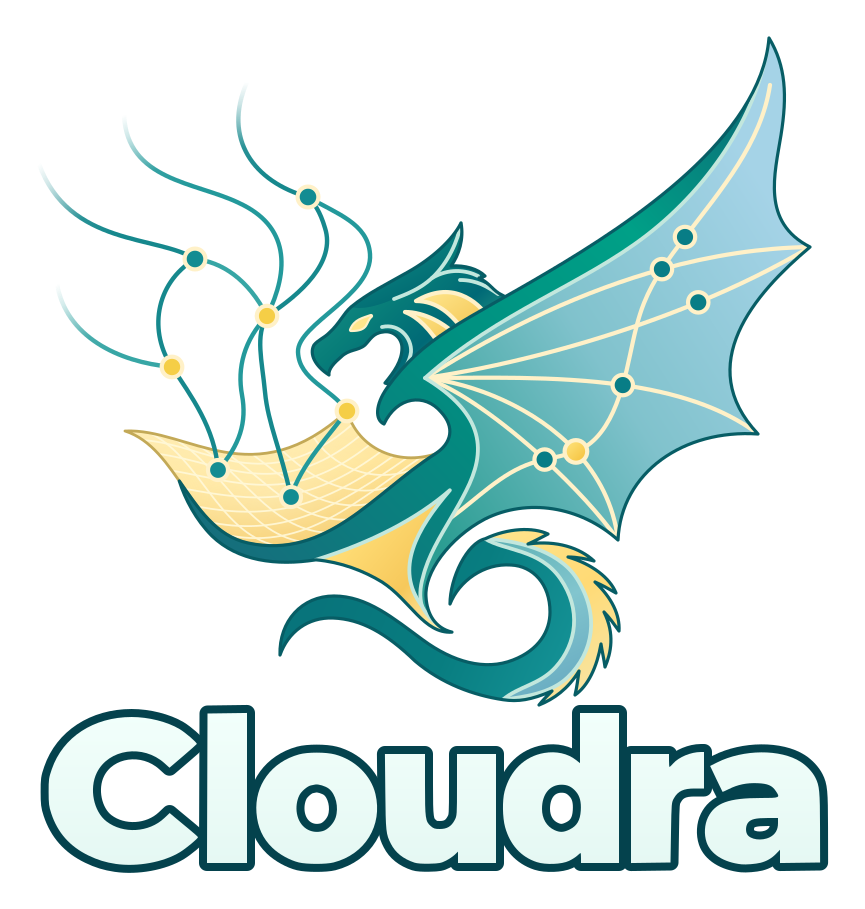

# Cloudra

<p align="center">
  
</p>

[](https://github.com/yyywaa/Cloudra-mechanism-agent/actions/workflows/ci.yml)
[](pyproject.toml)
[](LICENSE)

[English](README.md) · [使用文档](docs/README.md) · [论文与数据](docs/RESEARCH_DATA_CN.md) · [参与开发](CONTRIBUTING.md)

这里是Cloudra，一个属于理论计算化学家，实验化学家的Agent。

在上一个版本中，定位为**面向有机小分子反应机理探索的计算化学智能体。**

Cloudra会继续维护，我们会增强Agent的性能，尝试引入周期性体系计算，MD等需求广泛的领域。Cloudra的目标是成为通用的化学智能体，我们正在为此努力。

Cloudra 预印本已在 [arXiv](https://arxiv.org/abs/2611.02909) 公开。

## 可以怎样使用

目前支持web UI，请参看下面的教程启动web UI。

新建项目，在对话框中用自然语言描述你的计算化学需求，例如：

> 请研究...反应物和...产物之间的反应路径。积极向我汇报；不懂就问问题。
>
> 帮我查询...领域的文献，聚焦于...
>
> 帮我写关于...的脚本/代码...

研究过程中可以查看 Agent 的讨论（智能体论坛）与工具结果、计算队列（由Cloudra内部自造的小型hpc程序支持）和原生日志等。使用机理图模式（dag-guided）时，还可以查看物种、三维结构、反应步骤及其证据状态。这些在控制台中查看。

控制台的「结构、计算与机理」页面统一展示结构、计算和文件产物；standard 项目也可直接使用。点击结构预览或按 **Alt+M** 打开独立分子窗口，可查看实际计算帧与模式，编辑结构、定义冻结／扫描并保存给 Agent。操作见[分子工作台指南](docs/MOLECULAR_WORKBENCH_CN.md)。

## 安装与启动

下载适合自己系统的安装包，双击安装，再从桌面或应用程序打开 Cloudra。安装包已包含 Python、Node.js、基础依赖和网页界面，无需先安装开发工具。详细步骤见[新手安装教程](docs/INSTALL_CN.md)。

| 系统 | 安装方式 |
| --- | --- |
| macOS | 双击 `.pkg` 安装，再打开“应用程序”中的 Cloudra；见[macOS 教程](docs/INSTALL_CN.md#macos-安装)。 |
| Linux | 安装 `.deb`，或解压便携 `.tar.gz`，然后打开 Cloudra；见[Linux 教程](docs/INSTALL_CN.md#linux-安装)。 |
| Windows，原生运行 | 双击 `Setup.exe` 安装，从开始菜单或桌面打开；见 [`windows` 分支教程](https://github.com/yyywaa/Cloudra-mechanism-agent/blob/windows/docs/INSTALL_WINDOWS_CN.md)。 |

当前安装包通过成功打包后的 [GitHub Actions 构建产物](docs/INSTALL_CN.md#下载安装包)提供，尚未发布为正式 Releases；macOS 测试包尚未完成开发者签名和公证。开发者及自行部署的用户可按[源码安装步骤](docs/INSTALL_CN.md#从源码安装)使用现有安装脚本。

1. 在全局设置（Global Setting）中配置主 Agent 与协作 Agent 的模型。可使用 OpenAI 兼容接口，也可选择 ChatGPT / Codex 账号登录。同时，也可以选择您偏好的前端UI风格。
2. 配置研究所需的计算软件和节点；远端计算（如基于SLURM的集群计算）见[部署指南](docs/README.md#部署与配置)。
3. 创建项目，选择工作目录，放入结构或已有计算文件，说明任务及计算范围后开始研究。

当然，您也可以将它作为一个普通的研究助手进行实验，如查文献，调研，写代码等。

模型登录、联网搜索、常用命令及远程访问设置见[配置指南](docs/CONFIGURATION_CN.md)。

### 保留源码安装

准备 Python ≥ 3.11、Node.js ≥ 22.12 和 npm 后，仍可使用原来的安装与启动方式：

```bash
git clone --branch master https://github.com/yyywaa/Cloudra-mechanism-agent.git
cd Cloudra-mechanism-agent
bash install.sh
source .venv/bin/activate
cloudra
```

也可以直接运行 `bash web.sh`。完整步骤见[源码安装](docs/INSTALL_CN.md#从源码安装)。

### macOS 首次打开被拦截

macOS 安装包旁附带 [Unblock-Cloudra.command](packaging/macos/Unblock-Cloudra.command)，仅对确认来自本仓库的 Cloudra 下载使用。

打开“终端”，输入 `bash `（末尾留一个空格），把脚本拖入终端并按回车。脚本会处理同文件夹中的 Cloudra `.pkg` 和已安装的 `Cloudra.app`；如提示密码，输入 Mac 登录密码。完成后重新打开安装包或应用。

也可指定路径：

```bash
bash /路径/Unblock-Cloudra.command /Applications/Cloudra.app
```

## 三种工作模式

在项目设置中选择：

| 模式 | 适合怎样的工作 |
| --- | --- |
| `standard`（默认） | 普通任务。 |
| `dag_record` | 用机理图记录物种、反应步骤和证据，由执行 Agent 绑定结果。 |
| `dag_guided` | 单个反应的反应机理探索任务，全自动完成交付。 |

请注意，这个standard模式和论文中讨论的backbone基线并不是同一个实现。

具体的图交付机制见 [DAG 说明](docs/DAG_ORCHESTRATION.md)，过渡态流程及证据要求见 [TS 指南](docs/TS_PROCESS_SOP.md)。

## 论文、数据与复现

论文 **Cloudra: Geometric Reasoning and Scientific Validation for Autonomous Reaction Mechanism Exploration** 已作为预印本公开：[arXiv:2611.02909](https://arxiv.org/abs/2611.02909) [cs.MA]，DOI：[10.48550/arXiv.2611.02909](https://doi.org/10.48550/arXiv.2611.02909)。

[研究数据与复现入口](docs/RESEARCH_DATA_CN.md)按用途区分：复现论文图表、检查 Agent 原始运行、审查 Gold 参考计算，以及重新运行 Benchmark。正式题库含 50 题；P2 对应四种配置、200 次保留运行。P2 完整归档（14.9 GB）已公开只读，文件名、校验值和下载说明见[交付页](docs/benchmarks/P2_DELIVERY.md)。

## 参与与引用

默认协议是 `javascript`；`traditional` 是 per-agent 可选设置。

欢迎提交问题、使用反馈和改进建议。报告计算问题时，附上软件版本、环境、任务描述、输入文件及相关日志，会更容易定位原因。开发约定见 [CONTRIBUTING.md](CONTRIBUTING.md)，系统结构见[架构说明](docs/ARCHITECTURE.md)。

使用本项目开展研究时，请引用论文，并记录所用软件提交版本：

> Chengyi Yang, Qianxin Zhou, and Yang Li. *Cloudra: Geometric Reasoning and Scientific Validation for Autonomous Reaction Mechanism Exploration*. arXiv:2611.02909 [cs.MA], 2026. [doi:10.48550/arXiv.2611.02909](https://doi.org/10.48550/arXiv.2611.02909).

[BibTeX](CITATION.bib) · [GitHub 引用信息](CITATION.cff) · [arXiv 预印本](https://arxiv.org/abs/2611.02909)。

## 许可证

Cloudra 采用 [AGPL-3.0-or-later](LICENSE)。`cloudra/skills/` 中声明 MIT 的技能使用 MIT 许可证；随仓库分发的第三方组件保留各自许可证，见[第三方归属](docs/licenses/README.md)。贡献采用 Developer Certificate of Origin，提交时请签署 `git commit -s`。
