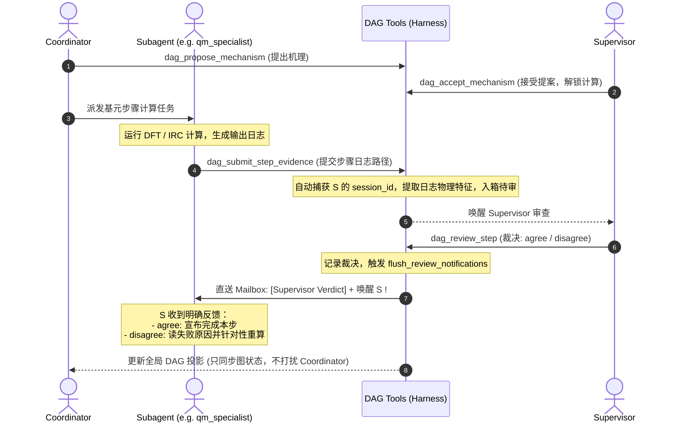

# DAG 子系统 Schema 全面瘦身与重构详细实施方案 (V2)

## 1. 概述与核心目标

当前 Cloudra 的 DAG 子系统（机理交付与督导复核机制）积累了大量的历史包袱，导致模型交互极度痛苦、底层实现向顶层泄露。本次重构的核心目标是：
1. **声明式提案**：彻底废除 AST 算子流、手动 ID、僵尸字段 `graph: "delivery"`、冗余 `role` 和机械式 10 阶段数组，LLM 仅需声明化学物种与步骤（从 150+ 行压缩到 20 行）。
2. **只认文件，不认 ID 与工具名**：彻底废除模型查找 `tool_call_id` 的反人类交互，废除把具体工具名 `ts_guess` 写入阶段的泄露设计；模型仅需提交物理计算日志路径。
3. **收敛 IRC 与端点过度门禁**：废除 `endpoint_a`, `endpoint_b`, `direction`, `identity` 4 个碎片化阶段，收敛为统一的 `ts_verification`，由底层自动提取 IRC 两端并核验连通性。
4. **子 Agent 闭环精准通信（谁提交谁得到结果）**：Supervisor 的裁决（`agree` / `disagree` / `needs_evidence`）精准路由至提交该计算的子 Agent 会话并立即唤醒，形成闭环自愈，无需 Coordinator 充当二传手。
5. **清理底层平行追踪冗余**：清理边上的 7 个硬编码布尔位，统一阶段与完成度评估，彻底剥离旧 process 图的残留代码。

---

## 2. 核心架构设计：Supervisor 与子 Agent 通信闭环

针对用户强调的 **“谁提交的申请，谁得到结果”**，重构后的多 Agent 证据提交与复核通信闭环设计如下：



### 通信机制细节保障：
1. **会话身份自动锚定（零模型输入）**：
   * 子 Agent 调用 `dag_submit_step_evidence` 时，工具底层直接从当前上下文的 `Session.session_id` 和 `Session.role_id` 自动提取提交者身份，存入待审记录中。
   * 模型不需要手填任何身份 ID。
2. **定向精准投递（Direct Mailbox Delivery & Wake）**：
   * Supervisor 使用 `dag_review_step` 裁决时，生成持久化的 `verdict_notification`，其 `recipient_session_id` 严格绑定回当时的提交者 `session_id`。
   * 系统通过 `core.mailbox.deliver` 直送子 Agent 个人信箱，并调用 `core.agent_host.wake(subagent)` 确保子 Agent 立即感知。
3. **闭环行为准则**：
   * **若 `verdict == "agree"`**：子 Agent 明确本步骤已被督导签字认可，任务完成，向 Coordinator 汇报成功；
   * **若 `verdict == "disagree"` 或 `"needs_evidence"`**：通知内容包含 Supervisor 的详细物理理由（如 *“虚频过小（-15 cm-1），IRC 未能滑脱，请微调初猜重算”*），子 Agent 直接原地诊断重跑，不需要人工介入和层层转发。
   * **Coordinator 视角解耦**：Coordinator 只通过 `dag_view` 观察交付图的整体点亮状态，解脱管理开销。

---

## 3. 六大 Schema 重构规范

### 3.1 Schema 1：机理提案 (`dag_propose_mechanism`)
* **定位**：Coordinator 提出初始假设，唯一暴露给模型的设计。
```jsonc
{
  "rationale": "基于文献报道的碱催化脱质子及协同加成反应机理",
  "species": [
    { "name": "Acetaldehyde", "smiles": "CC=O" },
    { "name": "Enolate Intermediate", "smiles": "C=C[O-]" },
    { "name": "Aldol Product", "smiles": "CC(O)CC=O" }
  ],
  "steps": [
    {
      "name": "质子抽提形成烯醇负离子",
      "from": "Acetaldehyde",
      "to": "Enolate Intermediate",
      "barrierless": false // 默认 false；只有无能垒步骤才填 true
    },
    {
      "name": "亲核进攻生成产物",
      "from": "Enolate Intermediate",
      "to": "Aldol Product",
      "barrierless": false
    }
  ]
}
```
* **后台全自动装配**：
  * 自动分配内部 ID（`sp_1`, `sp_2`, `step_1`）；
  * 自动推导物种拓扑角色（`reactant` / `intermediate` / `product`）；
  * 自动装配阶段契约：物种配 `[geometry, frequency, single_point]`，步骤配 `[ts_verification, thermochemistry]`。

---

### 3.2 Schema 2：成果提交 (`dag_submit_step_evidence` / `dag_submit_species_evidence`)
* **定位**：子 Agent 算完后向系统交工的统一出口。
```jsonc
// 步骤成果提交
{
  "step": "质子抽提形成烯醇负离子",
  "ts_log": "runs/step1_ts_freq.out", // 过渡态频率计算日志（系统自动验1个虚频）
  "irc_log": "runs/step1_irc.out",     // IRC 计算日志（系统自动核验两端连通性）
  "summary": "定位到质子转移TS，虚频-420cm-1，两端连通底物与中间体"
}

// 物种成果提交
{
  "species": "Acetaldehyde",
  "log_path": "runs/acetaldehyde_opt.out" // 优化与频率日志（系统自动验0虚频）
}
```
* **彻底剥离**：无 `tool_call_id`、无 `ts_guess`、无 `endpoint_a/b/dir/ident` 碎片，只认文件。

---

### 3.3 Schema 3：动态局部增删改 (`dag_add_species` / `dag_add_step` / `dag_remove_step`)
* **定位**：探索过程中发现新物种或新路径时的增量修改。
```jsonc
// 动态添加物种
{
  "name": "Enol Tautomer",
  "smiles": "C=C(O)C"
}

// 动态添加连线
{
  "name": "烯醇互变步骤",
  "from": "Acetaldehyde",
  "to": "Enol Tautomer",
  "barrierless": false
}

// 废弃/移除步骤
{
  "step": "烯醇互变步骤",
  "rationale": "能量过高，热力学不可行，予以废除"
}
```

---

### 3.4 Schema 4：督导审查与裁决 (`dag_review_step` / `dag_accept_mechanism`)
* **定位**：Supervisor 专属工具。
```jsonc
// 接受/驳回初始草稿
{
  "verdict": "accept", // accept | reject
  "rationale": "机理合理，符合基础有机反应规律，准予计算"
}

// 审查步骤成果（整体验收）
{
  "step": "质子抽提形成烯醇负离子",
  "verdict": "agree", // agree | disagree | needs_evidence | skip | not_applicable
  "reason": "虚频向量方向正确，两端与物种几何匹配度良好"
}
```
* **后台分发**：一旦裁决，系统自动根据步骤待审记录找到对应的提交子 Agent，直接回传。

---

### 3.5 Schema 5：图状态投影 (`dag_view`)
* **定位**：模型和 UI 统一读取的数据视图。
```jsonc
{
  "species": [
    { "id": "sp_1", "name": "Acetaldehyde", "smiles": "CC=O", "role": "reactant", "status": "supported" },
    { "id": "sp_2", "name": "Enolate Intermediate", "smiles": "C=C[O-]", "role": "intermediate", "status": "supported" }
  ],
  "steps": [
    {
      "id": "step_1",
      "name": "质子抽提形成烯醇负离子",
      "from": "sp_1",
      "to": "sp_2",
      "barrierless": false,
      "status": "supported",
      "ts_result": {
        "imag_freq": -420.5,
        "irc_connected": true,
        "barrier_kcal": 15.2
      }
    }
  ],
  "pending_reviews": []
}
```

---

### 3.6 Schema 6：完工评估报告 (`dag_delivery_report`)
* **定位**：Coordinator 在调用 `stop` 宣告交付前自检的确定性依据。
```jsonc
{
  "is_complete": false,
  "satisfied_steps": 1,
  "total_steps": 2,
  "unresolved_gaps": [
    {
      "step": "亲核进攻生成产物",
      "status": "pending",
      "reason": "尚未提交已验证的过渡态日志"
    }
  ]
}
```

---

## 4. 详细代码改造实施计划

### Component 1: 模型层改造 (`cloudra/dag/models.py`)
- [ ] **收敛步骤阶段词表**：
  - 新增 `StageKind.TS_VERIFICATION = "ts_verification"`；
  - 将旧有的 `ts_guess`, `ts_opt`, `short_irc`, `endpoint_a`, `endpoint_b`, `direction`, `identity` 保留为向后兼容映射，内部统一收敛到 `ts_verification`；
- [ ] **清理 `ElementaryStepEdge` 冗余字段**：
  - 将 7 个派生布尔位（`saddle_supported`, `short_irc_supported` 等）降级为只读兼容属性，内部不再持久化；
  - 简化 `OccurrenceNode`，去除强制手写的 `role` 约束；
- [ ] **清理旧 process 图死代码**：
  - 放宽 `_OperationBase` 的 `graph` 字段校验，默认自动填充为 `GraphKind.DELIVERY`；
  - 标记废弃 `PlannedNode`, `ObservedNode`, `DependencyEdge`, `AddLink`。

### Component 2: 声明式提案工具改造 (`cloudra/tools/Plantool/dag_tools/`)
- [ ] **重构 `proposal_inputs.py`**：
  - 定义简洁的 `SpeciesSpec`、`StepSpec` 与 `MechanismProposalInput`；
- [ ] **升级 `dag_propose_mechanism.py`**：
  - 替换输入 Schema 为极简结构；
  - 编写后台自动装配引擎：
    1. 自动生成规范 ID（`sp_1`, `step_1`）；
    2. 计算节点有向图出入度，推导 `role`；
    3. 自动赋予标准阶段（Node 赋 `opt+freq+sp`，Edge 赋 `ts_verification+thermo`，无能垒赋 `not_applicable`）；
    4. 提交原子批次。
- [ ] **重构证据提交工具 `dag_bind_evidence.py`**：
  - 新增支持直接传 `step` + `ts_log` + `irc_log`；
  - 自动调用后台日志提取器，检验 1 个虚频与 IRC 端点连通性；
  - 自动绑定当前会话的 `session_id`。
- [ ] **简化单点维护工具**：
  - 简化 `dag_add_species.py` 与 `dag_add_step.py`，允许自然语义输入。

### Component 3: 审查路由与闭环通信改造 (`cloudra/dag/evidence_inbox.py` & `supervision.py`)
- [ ] **重构 `dag_review_call.py` (即新 `dag_review_step`)**：
  - 审查直接针对步骤和物种，不再按 10 个碎裂 stage 逐项审；
- [ ] **加固“谁提交谁接收”通知分发**：
  - 确保证据送审记录中精准记录了子 Agent 的 `caller_session_id`；
  - 在 `flush_review_notifications` 中，严格将裁决定向投递给 `recipient_session_id`，并触发 `core.agent_host.wake(subagent)`；
  - 在子 Agent 系统提示词中明确规范：收到 `disagree` / `needs_evidence` 裁决通知后，立即根据理由就地修复，完成闭环。

### Component 4: 交付评估与简化投影 (`cloudra/dag/completion.py` & `store.py`)
- [ ] **简化 `evaluate_delivery` 逻辑**：
  - 去除双重检查（不再叠床架屋跑 `evaluate_claim`）；
  - 只要每个必须物种有结构支持，每个基元步骤 `ts_verification` 达到 `supported`（或为 `barrierless`），即视为机理完工；
- [ ] **压缩 `DagProjection` 视图输出**：
  - `dag_view` 输出剔除 7 个布尔位和冗长 AST，仅返回精简可读的机理网络。

---

## 5. 迁移与向下兼容策略

1. **读取兼容（Read Compatibility）**：
   - 历史 SQLite 数据库中的旧数据（包含旧 stages、7 个布尔位、旧 review 记录）通过读取适配器无缝映射到新结构，不破坏已有项目的回放；
2. **测试用例适配（Test Suite Compatibility）**：
   - 现有 `tests/test_dag_*` 涵盖了大量的旧数据格式测试：
     * 保持引擎底层的 `AddNode` / `AddEdge` 处理能力（新工具作为上层装配器）；
     * 逐步将各测试套件的输入迁移为声明式提案，确保测试全部通过。

---

## 6. 验证与验收方案

### 自动化测试命令
```bash
# 1. 单测：测试机理提案自动推导物种角色与自动注入阶段
uv run pytest -q tests/test_dag_drafts.py

# 2. 单测：测试日志直接绑定证据、虚频校验与 IRC 连通性核验
uv run pytest -q tests/test_dag_tools.py

# 3. 集成测试：测试子 Agent 提交成果 -> Supervisor 裁决 -> 子 Agent 收到通知并唤醒全流程
uv run pytest -q tests/test_runtime_v2_supervision.py tests/test_dag_supervision.py

# 4. 全套 DAG 回归测试与 Lint 检查
uv run pytest -q tests/test_dag*
uv run ruff check cloudra/dag cloudra/tools/Plantool/dag_tools
```

### 真实场景人工验收
1. 启动 Web 界面，使用 Coordinator 提出简单反应机理（如烯烃氢卤化）；
2. 观察 Coordinator 输出的工具调用是否只有极简的 `species` 和 `steps`（~20 行 JSON）；
3. 检查 Supervisor 是否能一键接受机理草稿；
4. 模拟子 Agent（如 `small_mol`）提交计算日志路径，检查 Supervisor 裁决 `agree` / `disagree` 后，子 Agent 是否精准收到通知并被正确唤醒；
5. 检查 DAG 交互面板，验证节点与连线是否正确点亮。
