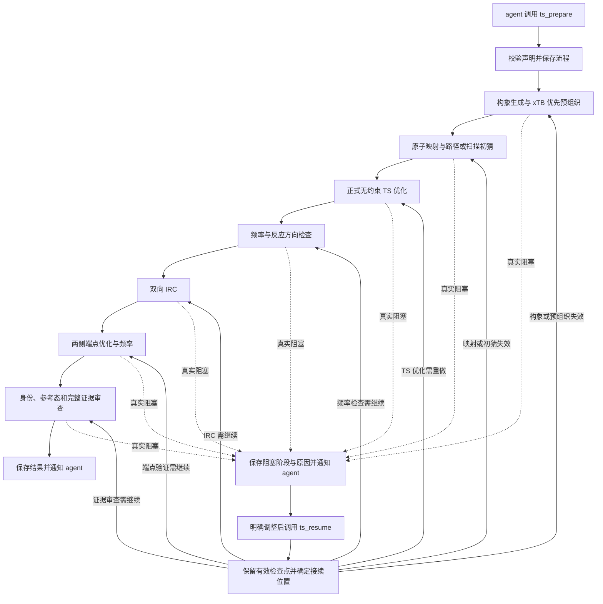

# ts_prepare 自动推进、优化后端与恢复机制设计

日期：2026-10-01
状态：构象接续所需前置依赖已实现，完整方案尚未全部实现；未部署
范围：Cloudra 的 TS 初猜准备及既有 QM 验证链；通用计算执行规则同时适用于其他计算工具。

## 1. 目标与已确认需求

一次 `ts_prepare` 应启动一个可持久化、自动推进的计算流程。正常情况下，计算结束后由系统解析结果、检查证据并提交下一步，agent 不需要调用 `ts_resume`。agent 负责选择化学问题、处理真实阻塞和审查最终结果。

用户已确认的要求：

1. 单分子和多分子络合物的优化都先用 xTB，MMFF 是回退路径。
2. 所需限制优化若没有适配的原生后端，应提供优化算法支持。
3. 参考 autodE 的代码和成熟算法，不引入 autodE 或其他新依赖。只使用仓库现有依赖和已配置的计算引擎。
4. 任何计算任务不得因 Cloudra 设定的时间上限而被结束。
5. Cloudra 不另设优化、扫描、路径或计算迭代次数上限；原生软件使用自身默认值，只有用户明确指定时才传入覆盖值。
6. `ts_resume` 用于阻塞后的明确干预，不是正常完成一个作业后必须调用的推进工具。
7. 工程改造不得自动改变机理、方法、溶剂、电荷、自旋、能垒参考态或科学验收口径。

实现阶段不运行用户 Mac 上的 QM，不停止现有 QM，不为部署重启正在承载 agent 的服务。正式 benchmark 不属于本次变更范围。

## 2. 当前问题与设计选择

目前单分子结构优化主要走 MMFF→UFF，多分子组装松弛主要走 MMFF；xTB 更多出现在后续路径阶段。因此“路径使用了 xTB”不能证明初始结构优化使用了 xTB。

现有 `ts_process` 已有阶段、持久化记录和计算账本，但后续作业常依赖 agent 收到计算通知后调用空 adjustment 的 `ts_resume`。工具内部还有若干计算超时、结构松弛步数和路径运行次数限制。

本设计选择：**参考 autodE 的阶段检查点、受限优化和扫描代码，在 Cloudra 现有流程与账本中实现必要部分**。不另建调度系统，不运行 autodE 整套 reaction profile，不把它的默认化学模型或进程控制照搬过来。

| 内容 | 采用方式 | 保留的 Cloudra 责任 |
| --- | --- | --- |
| reaction profile 分阶段与检查点 | 模仿阶段完成后保存、恢复时跳过完成阶段的组织方式 | 数据校验、任务所有权、幂等提交与恢复 |
| xTB 包装 | 参考输入生成、梯度读取、限制声明等代码 | 既定 GFN/溶剂、计算账本、节点与资源管理 |
| CRF/RFO 受限优化 | 移植必要的数值算法与配套坐标/Hessian 逻辑，改为内部模块 | 梯度作业提交、轨迹持久化、限制语义核验 |
| RelaxedPES | 模仿扫描点组织和邻近结构种子复用 | 全局资源额度、扫描范围来源、点级检查点 |
| IDPP/路径种子 | 复用已有实现，参考上游组织方式 | 种子与真实 TS 的区分、失败证据 |
| 结果验收 | 不照搬上游简化判定 | 原子映射、立体身份、相关虚频、IRC 与端点证据 |

## 3. 无新依赖与源码来源

研究基线为 duartegroup/autodE 的 commit `e7e71b33d8659fe921c16f877f9c1adddc4f9cff`。实现时必须固定所参考的版本，避免写成“参考最新上游”而无法复现。

- 不增加 `autode` 安装、运行时 import、CLI 调用或隐式下载。
- 不为移植安装 Cython、loky 或其他新包；也不把缺失的新包藏在可选安装流程中。
- 数值部分使用现有环境已有的数组和线性代数能力；化学图、构象和现有引擎接口沿用当前依赖。
- 移植模块必须闭合其必要依赖。不能只复制 `CRFOptimiser` 类而遗漏内部坐标、Hessian 更新、单位和收敛判断。
- 移植源码或实质衍生代码时，保留上游 MIT 许可与版权声明，记录上游文件、commit 和本地改动。单纯借鉴设计也记录出处。
- 不照搬上游 executor 的默认 `50` 次优化上限、检查点按耗时决定是否保存的逻辑、独立进程池或溶剂默认值。

本次仅写设计；没有安装依赖、复制产品代码或改变部署。

## 4. 优化策略

### 4.1 单分子

调用顺序：

`化学图/原子身份 → RDKit 构象嵌入 → xTB 原生优化 → 几何与收敛检查 → 可用构象`

RDKit 嵌入是坐标生成，不是 MMFF 优化。电荷、自旋和已声明的探索溶剂随 xTB 请求传递。构象数属于搜索规模，须显式记录其来源；不能借它暗中限制一次优化的迭代。

xTB 整体不可用时，可以进入 MMFF 回退；仅原生优化器不能表达限制而能量/梯度后端仍可用时，先使用第 4.2 节的内部受限优化器。回退前必须记录具体原因，输出中写明实际后端。MMFF 缺参数时，可保留既有 UFF 能力作为明确标注的末级回退；不得把 UFF 结果标成 MMFF 或 xTB。

xTB 的 SCF 失败、几何发散或软件报告未收敛，必须保留为该尝试的失败证据，不得仅因“结果不理想”无提示换成 MMFF。是否改变初猜或搜索路径交给明确干预。

### 4.2 多分子络合物与环状预组织

调用顺序：

`各组分生成/优化 → 反应中心与环构型放置 → 消除碰撞 → xTB 受限优化 → 限制/身份核验 → 构象筛选`

单分子和络合物都遵循 xTB 优先。多分子松弛不能继续隐藏在 MMFF-only 的组装函数中。

限制优化后端按能力选择：

1. 原生 xTB 优化器能够表达请求且结果满足约束语义时，使用原生优化器。
2. 原生优化器不能满足请求，而 xTB 可以提供能量与梯度时，使用参考 autodE 实现的内部受限优化器，以 xTB 为能量/梯度后端。
3. xTB 整体不可用且 MMFF 参数与限制能力满足需求时，使用明确标注的 MMFF 回退。
4. 没有适配后端时进入 `blocked`，报告缺少的能力，不输出貌似成功的预组织结构。

软限制与严格约束必须分开记录。距离区间、距离等式、冻结坐标和环拓扑不能互相替代。例如，区间 `[a,b]` 不得悄悄变成固定在中点的等式。内部受限优化通过区间边界的活动约束处理越界，区间内不增加中点吸引；冻结自由度从可动空间中移除。若某类约束尚未支持，就报告不支持。

优化结束必须检查实际坐标是否满足限制、是否碰撞、组分是否解离、化学图和立体身份是否保持。引擎正常退出本身不足以通过这些检查。

### 4.3 内部优化器的边界

参考 CRF/RFO 的信赖域、约束坐标、Hessian 更新和收敛判断；不另发明一套优化方法。能量/梯度评估使用现有计算执行入口，每次评估归属同一优化尝试并保存轨迹。

内部移植实现按数值收敛、明确的数值失败或显式取消结束。**不得新设 Cloudra 的总迭代、函数评估次数或时间上限。**原生软件存在的默认次数限制保留，并把其实际终止原因记录下来。移植算法没有原生引擎默认值可继承时，不从上游 executor 搬来一个次数上限冒充软件默认值。

信赖半径、收敛容差等是数值算法参数，不是任务预算；采用参考实现的有来源默认值并记录，不自动放松以制造成功。用户指定的限制和参数进入请求记录。

### 4.4 能量与排序

不同后端的能量不得混排。需要比较候选时，必须具有同一方法、溶剂、电荷、自旋及一致的能量定义。回退候选先保留几何与来源，只有取得统一方法的能量后才进行共同能量排序。

xTB、MMFF、UFF、IDPP 和扫描峰都只是初猜证据。金标能垒仍由既定正式计算方法及参考态产生。

## 5. 正常自动调用链

图中每个计算阶段均可异步等待。API 返回流程 ID、当前状态和计算 ID 后结束该次请求；这不终止流程或计算。等待期间不持有数据库事务，也不阻塞 API 事件循环。

`ts_resume` 在同一个流程内续接，不固定回到构象生成或预组织。图中的接续分支每次只选择一个入口：调整不影响已完成上游时，从原阻塞阶段继续；调整改变上游输入时，退回最早失效的阶段，再沿依赖继续。已完成且仍有效的阶段及独立分支保持原作业和证据，不重新提交。

具体规则：

- 保留现有阶段组织，但将完成事件驱动的推进从 agent 移至系统。
- `build/assemble` 的计算也纳入持久化执行，不能在工具请求中启动不可恢复的长期子进程。
- xTB 路径不可用时，沿既定适用条件使用 IDPP；已有 xTB 尝试失败时保留失败，不把任何失败统一改写为“未安装”再回退。
- TS 优化完成后解析真实输出；频率和相关反应方向通过既有标准，才继续 IRC。错误扭转鞍点不得因恰好有一个虚频继续当反应 TS。
- IRC 两个方向的可用轨迹按当前验收口径判定，不额外新增“必须 IRC 自身完全收敛”的要求。
- 对实际 IRC 端点进行必要的无约束优化、频率与身份核验。可复用同方法、同身份、有充分来源的既有计算，不重复提交。
- 最终 verdict 保留已约定的相关一阶鞍点、原子映射、立体身份、端点极小值与参考态检查。
- 计算完成不能直接触发题库回填；回填仍沿此前科学审查和用户授权规则。

## 6. 持久化、幂等与恢复

### 6.1 唯一账本

使用现有 compute 数据库作为执行事实来源。增加必要的流程/阶段绑定，不新增第二套任务队列：

- 流程记录：`process_id`、schema 版本、项目、所有者、声明版本、状态、当前阶段、阻塞及最终证据引用。
- 阶段尝试：`process_id + declaration_revision + stage_key + attempt` 为唯一键；扫描点/梯度点具有确定的子键。
- 作业绑定：阶段尝试关联既有 `compute_job_id`，记录后端、输入摘要、资源、产物及解析结果。
- `process.json` 保留为可读导出与证据索引；调度幂等性由数据库唯一键和事务保障，不能靠文件存在判断。

输入准备完成后，在同一事务内创建阶段尝试、绑定并插入 READY 计算；重复完成事件或重复推进请求命中同一唯一键，只返回已有作业。输入采用不可变版本文件，运行中的输入不能被新调整覆盖。

声明修订只为失效阶段建立新尝试；仍有效的阶段继续引用原尝试及其证据，并记录跨修订复用关系。不能因为 `declaration_revision` 增加，就给所有已完成阶段重新建作业。失效范围按实际依赖传播；IRC 某一方向或某一个端点受影响时，独立且仍有效的另一侧结果保留。

### 6.2 自动推进入口

compute 完成事件发现流程绑定时，调用确定性的推进器：先解析已完成作业、保存阶段证据，再判断下一步。普通独立计算沿用现有通知方式；流程内部每个正常阶段完成不必唤醒 LLM。

进程启动或连接恢复时，reconcile 读取未完成流程及其绑定作业，处理尚未消费的终态。它不是 `ts_resume`，也不需要 agent 发消息。

并发推进以流程版本和短事务协调；可以使用可恢复的协调租约，但租约到期只释放推进权，不能结束 QM 或宣告化学失败。不得在等待引擎、读取大文件或解析输出时长期持有写锁。

### 6.3 必须覆盖的崩溃点

1. 输入已生成，READY 尚未入账：恢复同一尝试，创建一次作业。
2. READY 已入账，响应尚未返回：恢复绑定，不再提交。
3. 计算结束，解析尚未完成：从保存的原始产物重做解析。
4. 解析完成，下一步尚未创建：根据持久化阶段证据继续。
5. 下一步已创建，完成通知被重复消费：唯一键阻止重复作业。
6. API、SSH 或推进器断开而 QM 仍运行：保留计算状态，重新连接核对；不能因连接失败将 QM 标为失败。

原始输出、轨迹和失败输入均保留。恢复时核对 schema、输入摘要和声明版本，不无条件加载上游 pickle 或信任目录里出现的任意文件。

## 7. ts_prepare 与 ts_resume 的接口职责

### ts_prepare

创建并启动新流程，返回流程 ID、状态、当前阶段、关联作业和证据位置。支持稳定的请求幂等键，防止调用方因响应丢失而重复启动。提交成功和科学成功必须使用不同状态。

### ts_resume

只接受 `blocked` 流程的明确 adjustment，例如修正原子映射、改变初猜或提供已获批准的约束。记录干预者、理由、声明差异和受影响阶段，再恢复自动推进。流程 ID 保持不变；返回接续阶段、实际失效范围及复用证据，明确这次调整会重做什么。

接续位置由阻塞位置和声明差异共同决定：

| 调整影响 | 接续方式 | 必须保留 |
| --- | --- | --- |
| 仅解决当前阶段的阻塞，上游输入未变 | 从当前阶段继续；仅在确需重新计算时建立该阶段的新尝试 | 全部有效上游作业与证据 |
| 修正原子映射，已构建的两端结构未变 | 从映射校验及其受影响的依赖阶段继续 | 已构建的两端结构与身份记录 |
| 重新生成或替换初猜 | 从初猜生成或校验的相应位置继续，再重做依赖该初猜的 TS 精修与验证 | 输入语义未变的结构、映射及其他有效上游证据 |
| 已支持且获授权的调整仅影响 IRC 某方向或某个端点 | 继续该方向或该端点及其受影响的证据审查 | 已验证的 TS、频率及仍有效的另一侧结果 |
| 改变构象生成或预组织输入 | 回到最早失效的构建或组装阶段，沿依赖重算 | 未受影响的组分、独立分支及原尝试归档 |

流程续接与引擎内部重启是两层能力。复用引擎检查点必须有后端支持，并核对方法、原子身份、输入与检查点兼容性；不能把从初始几何新起一次计算写成“从引擎中断步续算”。

- `waiting` 流程不接受重提；返回仍在等待的既有作业。
- 正常完成事件不调用 `ts_resume`。
- 空 adjustment 仅可作为旧客户端兼容性状态查询，不承担推进、重试或解除阻塞的功能；新提示词不再要求“完成后空 resume”。
- 改动只使受影响阶段及其下游失效，保留可复用且语义未变的完成证据。
- 不提供隐藏的自动干预次数预算。改变科学模型仍需相应用户授权，不能通过 resume 绕过。
- 显式取消使用既有账本取消入口，resume 不兼任取消或杀进程工具。

## 8. 时间、迭代与任务寿命

| 情况 | 必须行为 |
| --- | --- |
| 计算耗时长、暂时无新输出 | 保持运行/等待；可报告观察信息，不杀进程、不判失败 |
| API/SSH/数据库操作等待超过通信期限 | 结束或重试该通信操作，计算继续；通过账本核对未知结果 |
| 软件自身默认迭代上限耗尽 | 记录软件未收敛及已有证据，进入阻塞；不自动提高上限重跑 |
| 用户明确指定迭代参数 | 原样记录并传递，不由 Cloudra 再加更小的上限 |
| 外部调度器强制墙钟限制 | 不由 Cloudra 添加或伪装成无限；如外部结束作业，记录真实外部原因并保留可恢复产物 |
| 用户显式取消 | 经账本记录取消并按既有执行接口处理 |

需要统一审计的计算入口包括 xTB path、CREST、构象/预组织、电子分析、热化学分析、机制预测及正式 QM 提交。删除这些计算的 wall-clock kill；移除 Cloudra 注入的 `MaxIter`、`maxIts`、`nrun` 等预算覆盖值，保留软件默认行为及用户明确设置。

扫描点数、坐标范围、构象候选数是科学搜索声明，应有可审查的来源；不能混同优化迭代，也不能通过偷偷减少搜索范围来替代超时。

计算不得借通用 bash 的默认超时绕开本规则。已知计算入口走账本执行；通用 shell 的管理操作可以有通信期限，但不能据此终止其已启动的计算。不得靠易漏判的命令文本关键词决定是否允许杀计算。

运行后输出解析或分析若本身属于计算任务，同样不设终止任务的时间上限。引擎版本探测、锁等待及连接操作的期限必须与计算生命周期分开。

## 9. 资源与失败语义

所有流程、子 agent、优化梯度和扫描点共享节点注册表的 CPU/内存额度。引擎输入与账本申请一致，排队是正常状态。每任务核数由当前配置/请求决定，不在 TS 模块硬编码四核。本次不改变现行 Paratera 32 CPU/56000 MB 总额或用户优先八核的要求。

不沿用 autodE 的独立无约束进程池。内部优化器的梯度请求也必须受现有全局准入约束；不同时占一份外层全额资源又重复申请同一份内层资源。

| 类型 | 流程处理 | 自动行为 |
| --- | --- | --- |
| 正常完成且阶段证据合格 | 完成阶段，继续下一步 | 确定性推进 |
| 参数或后端能力缺失 | 阻塞，给出具体字段/能力 | 仅按第 4 节明确能力回退 |
| SCF/优化/路径失败 | 保存真实失败与轨迹，阻塞 | 不盲目重交或换方法掩盖失败 |
| 错误鞍点或端点身份 | 保存科学拒收证据，阻塞 | 不回填、不强行继续成功链 |
| 暂时连接失败或通知丢失 | 等待/待核对 | reconcile 已有作业 |
| 外部终止、进程退出、缺产物 | 保存实际状态，核对失败来源 | 不把调度完成当化学成功 |
| 显式取消 | cancelled | 不自动恢复 |

## 10. 验收标准

自动化验收使用可控的假引擎和事件回放；化学数值验证在授权的远程计算节点完成，不在 Mac 跑 QM。

1. **正常链**：一次 `ts_prepare` 经 TS、频率、IRC、端点到 verdict；整个过程 agent 调用 `ts_resume` 为零。
2. **两类结构**：单分子和多分子组装均先请求 xTB；回退输出包含原因和实际后端。
3. **限制语义**：距离区间、等式及冻结约束分别验证；区间内不被中点约束；不支持的限制明确阻塞。
4. **源码移植**：无新依赖、无 `autode` import；算法、必要支持代码与许可来源完整；受限优化通过有已知解的数值问题和梯度一致性检查。
5. **长计算**：人为推进测试时钟超过旧 timeout，计算仍活跃；连接期限不触发 QM kill。
6. **迭代**：默认引擎输入不写 Cloudra 预算上限；用户指定参数可追溯；移植优化器无额外总迭代上限。
7. **崩溃与重复事件**：第 6.3 节每种崩溃点恢复后，每阶段尝试恰有一个提交，不丢失证据。
8. **失败分流**：SCF 失败不伪装成 xTB 不可用；错误扭转虚频和错误立体端点均不能通过。
9. **证据一致**：后端间不混排能量；正式 RC/TS 使用统一方法版本和参考态；软件正常结束不等于有效 TS。
10. **兼容性**：旧 `process.json` 可识别并迁移或明确标为旧版；已运行旧流程先完成，不擅自接管造成重复计算。
11. **资源**：多个流程与普通计算共同排队，账本和实际核数一致，没有额外进程池突破额度。
12. **通知**：正常中间阶段由系统推进；最终结果或真实阻塞通知 agent；重复通知不产生重复计算。
13. **阻塞续接**：`ts_resume` 保持流程 ID，按第 7 节的调整影响选择接续位置。IRC 阶段受阻且上游未变时，不重建结构、不重做 TS 与频率；修正映射时不重建未变的两端结构；仅一侧受影响时不重算另一侧。验收检查实际作业 ID、提交数量及证据复用关系，不能仅检查返回的阶段名称。

## 11. 实现范围与交付顺序

后续实现按依赖顺序进行，不以此文档代替实施计划：

1. 统一计算寿命规则和引擎参数来源，明确移植代码的许可及边界。
2. 完成 xTB 优先的结构与络合物优化，以及必要的内部受限优化能力。
3. 将初猜计算与扫描纳入既有账本、阶段绑定和可恢复产物。
4. 接入 compute 完成事件自动推进，完成崩溃恢复与重复事件验证。
5. 收窄 `ts_resume`，更新工具契约、提示词和权威 SOP。
6. 在不影响现有计算的条件下，以远程真实科学任务验证，再决定部署切换。

主要模块范围：`structure_builder`、`complex_assembly`、`preorganization`、`xtb_path_runner`、必要的内部优化算法模块、`ts_process`、TS 工具接口、计算持久化/通知/执行入口及相关计算工具。

不在本次顺带新增反应题、改金标、换科学方法、扩展 benchmark 或重构全部 runtime。当前工作区其他改动不属于本 spec。

## 12. 参考来源

以下为设计及代码研究来源；实现时按固定 commit 对照并保留必要许可：

- [autodE 源码与许可证](https://github.com/duartegroup/autodE/tree/e7e71b33d8659fe921c16f877f9c1adddc4f9cff)
- [Reaction 阶段组织](https://github.com/duartegroup/autodE/blob/e7e71b33d8659fe921c16f877f9c1adddc4f9cff/autode/reactions/reaction.py)
- [阶段检查点](https://github.com/duartegroup/autodE/blob/e7e71b33d8659fe921c16f877f9c1adddc4f9cff/autode/utils.py)
- [CRFOptimiser](https://github.com/duartegroup/autodE/blob/e7e71b33d8659fe921c16f877f9c1adddc4f9cff/autode/opt/optimisers/crfo.py)
- [XTB wrapper](https://github.com/duartegroup/autodE/blob/e7e71b33d8659fe921c16f877f9c1adddc4f9cff/autode/wrappers/XTB.py)
- [RelaxedPES](https://github.com/duartegroup/autodE/blob/e7e71b33d8659fe921c16f877f9c1adddc4f9cff/autode/pes/relaxed.py)
- [TS 使用说明与现有局限](https://duartegroup.github.io/autodE/examples/tss.html)

Cloudra 核对基线：本地 TS 核心 `9fa8775b`，已知生产源码 `4021a79c`；部署前必须重新核对实际分支和接口，不覆盖现有独立改动。
