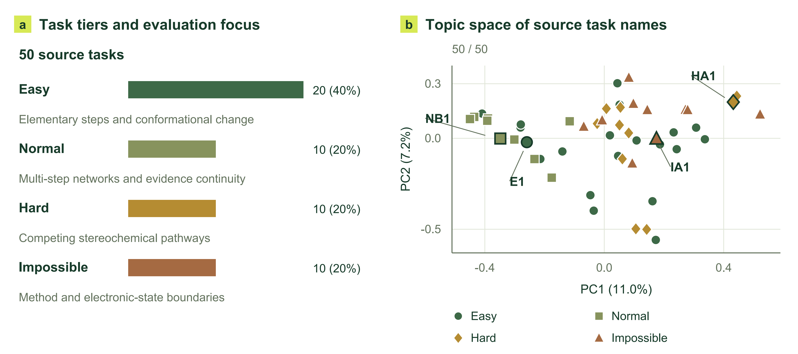

## 2 System Design and Methods

### 2.1 System Overview and Division of Responsibilities
Cloudra takes reactant identities, reaction conditions, target species or mechanistic questions, and computational requirements as inputs. It represents candidate elementary steps in a delivery evidence graph, generates molecular configurations, submits quantum chemical calculations, and associates returned structures, energies, frequencies, and paths with the corresponding species or steps. The graph stores proposed and verified chemical objects together with unresolved calculation requirements.

The multi-agent system divides responsibilities by functional role. The Coordinator formulates mechanistic hypotheses, proposes candidate elementary reaction steps, and maintains exploration branches. Computational agents execute assigned reaction steps, invoking geometric operators to assemble three-dimensional coordinates and scheduling quantum chemical calculations. When an assigned step encounters geometric divergence, saddle-point nonconvergence, or pathway bifurcation, the computational agent assesses whether the step remains viable; if the current step appears obstructed, it feeds diagnostic information back to the Coordinator to adjust the hypothesis or switch branches. The Supervisor independently audits the delivery graph against task specifications, maintaining review notes separately from parsed computational facts.

#### 2.1.1 Asynchronous Computation Scheduling and Resource Management
The computational execution harness is governed by a central calculation ledger (`ComputeDB`), which enforces state management across the lifecycle of each job. Dedicated capacity pools partition execution across local execution threads, remote SSH clusters, and Slurm supercomputing queues, enforcing hardware concurrency quotas to prevent queue overflow. Prior to dispatch, the scheduler computes an immutable SHA-256 content digest from Cartesian coordinates, electronic spin and charge, and level of theory; identical active or cached jobs are reused to achieve deduplication. Process liveness and execution concurrency are tracked via operating-system file exclusive locks (`flock`), avoiding termination of background quantum-chemistry jobs holding active locks during monitor exceptions. Computational agents interact with the scheduler via event-driven notifications: upon calculation termination, the harness dispatches completion events, allowing agents to read artifacts asynchronously without polling loops.

### 2.2 Molecular Representations and Geometric Operators
A molecular input consists of an attributed graph $H=(A,B)$ and Cartesian coordinates $\mathbf{X}\in\mathbb{R}^{n\times 3}$. Here $A$ is the atom set, $B$ is the bond set, and each row of $\mathbf{X}$ gives one atom position. Atom and bond attributes encode chemical identity; coordinate operators update $\mathbf{X}$ and return measured changes. Operators that replace atoms or functional groups also update $H$.

#### 2.2.1 Atom Correspondence and Reaction Centers
Atom attributes retain element, isotope, formal charge, hydrogen count, radical-electron count, and declared stereochemistry; bond attributes retain order and stereochemical labels. Components lacking three-dimensional coordinates are embedded using ETKDGv3 [6,7], then assembled if necessary. Existing coordinates are retained. Complete, unique atom-map labels on both endpoints define the correspondence directly and must agree in element and isotope. Otherwise, let $A_{\mathrm{P}}$ and $A_{\mathrm{R}}$ be the product and reactant heavy-atom sets. Candidate bijections $\pi:A_{\mathrm{P}}\to A_{\mathrm{R}}$ satisfy $z_i^{\mathrm{P}}=z_{\pi(i)}^{\mathrm{R}}$ and $\iota_i^{\mathrm{P}}=\iota_{\pi(i)}^{\mathrm{R}}$, where $z$ is atomic number and $\iota$ is isotope label. Each candidate is scored by

$$
J(\pi)=2(N_{\mathrm{f}}+N_{\mathrm{b}})+N_{\mathrm{o}}+4\Delta_H+8\Delta_q+8\Delta_r+2N_{\mathrm{s}}.
$$

Let $B_{\mathrm{P}}^\pi$ denote product bonds expressed in reactant atom indices. Bond formation and cleavage are the set differences $B_{\mathrm{P}}^\pi\setminus B_{\mathrm{R}}$ and $B_{\mathrm{R}}\setminus B_{\mathrm{P}}^\pi$, with cardinalities $N_{\mathrm{f}}$ and $N_{\mathrm{b}}$. The count $N_{\mathrm{o}}$ includes pairs in $B_{\mathrm{P}}^\pi\cap B_{\mathrm{R}}$ whose bond orders differ. For $a\in\{H,q,r\}$, the mismatch is $\Delta_a=\sum_{i\in A_{\mathrm{P}}}|a_i^{\mathrm{P}}-a_{\pi(i)}^{\mathrm{R}}|$, where $H$, $q$, and $r$ are the atom hydrogen count, formal charge, and radical-electron count. $N_{\mathrm{s}}$ counts stereochemical mismatches. Exactly one declared tetrahedral label contributes one mismatch, increasing $J$ by 2. When both corresponding atoms carry tetrahedral labels, the comparison requires four corresponding neighbors, including a single hydrogen where applicable; it corrects for neighbor-order parity before comparing the labels. Noncomparable two-sided tetrahedral environments contribute no mismatch.

For element–isotope classes of sizes $n_g$, the search space contains $N_\Pi=\prod_g n_g!$ bijections. All are enumerated when $N_\Pi\le 10^5$. Above this limit, MCS seeds use element matching, unrestricted bond-order matching, ring-to-ring matching, and complete rings [7]. The MCS timeout is 10 s, and each endpoint contributes at most 64 substructure matches. Unmatched atoms are paired within element–isotope classes after sorting by hydrogen count, degree, and input index. The search then merges candidates having identical bond-edit facts and score, keeping the lexicographically smallest mapping for each group. Representatives are sorted by score and then atom-map sequence; the first 16 form the heavy-atom candidate set $C$. For nonempty $C$, define optimal score $J_{\min}=\min_{\pi\in C}J(\pi)$ and tolerance set $\mathcal{N}=\{\pi\in C:J(\pi)\le J_{\min}+2\}$. An unlabeled mapping is reported as unique when $|\mathcal{N}|=1$, ambiguous when $|\mathcal{N}|>1$, and inconclusive when $C=\emptyset$.

The retained heavy-atom candidates are combined with compatible bindings to both concrete endpoint graphs and expanded to all-atom correspondences. Compatible explicit hydrogen labels are preserved first; remaining local hydrogens are paired by isotope on corresponding heavy atoms. For unmatched isotope groups of sizes $h_g$, the remaining $N_H=\prod_g h_g!$ permutations are enumerated when $N_H<257$. An expansion with $N_H\ge 257$ yields an inconclusive result unless compatible explicit hydrogen labels resolve the permutation space. Complete maps are deduplicated, ranked by score and atom-map sequence, and evaluated with the same +2 ambiguity criterion. The selected all-atom bijection reorders the product into reactant atom order. Formed and broken bonds define the reaction-center coordinate pairs used to monitor subsequent path interpolation, while bond-order modifications are recorded alongside the transformed graph.

#### 2.2.2 Structural Measurements and Rigid Body Operations
Structural perception converts coordinates into bond lengths, bond angles, dihedral angles, ring conformations, and close contacts. For coordinates $\mathbf{x}_i$, the interatomic distance is $d_{ij}=\|\mathbf{x}_j-\mathbf{x}_i\|$; the bond angle at vertex $j$ is obtained from the normalized dot product of the two bond vectors. Comparisons of distances with reference bond lengths and van der Waals contact scales provide geometric diagnostics, while the molecular graph retains the established identity. Connectivity is perceived at entry for coordinate-only inputs; subsequent local coordinate transformations retain this graph and remeasure anomalies before and after transformation.

Default fragment selection on either side of an acyclic bond uses graph connectivity: the specified bond $a-b$ is temporarily removed, and the connected component containing $b$, denoted $\mathcal{F}_b$, is selected. If the endpoints remain connected after bond removal, movement within a ring framework requires an explicit atom group. Let $\mathcal{F}$ denote the explicitly specified moving atom group or the component $\mathcal{F}_b$ obtained by bond removal. To rotate the selected fragment about an axis, Rodrigues' formula is applied to every $i\in\mathcal{F}$:

$$
\mathbf{x}_i'=\mathbf{a}+\mathbf{R}(\hat{\mathbf{u}},\theta)(\mathbf{x}_i-\mathbf{a}),\qquad\mathbf{R}=\cos\theta\,\mathbf{I}+(1-\cos\theta)\hat{\mathbf{u}}\hat{\mathbf{u}}^{\mathsf{T}}+\sin\theta\,[\hat{\mathbf{u}}]_\times.
$$

Here, $\mathbf{a}$ is a point on the axis, $\hat{\mathbf{u}}$ its unit direction, $\theta$ the rotation angle, $\mathbf{I}$ the identity matrix, and $[\hat{\mathbf{u}}]_\times \mathbf{v}=\hat{\mathbf{u}}\times\mathbf{v}$. Coordinates outside the selected set are unchanged. Stretching bond $a-b$ translates $\mathcal{F}_b$ as a whole:

$$
\mathbf{x}_i'=\mathbf{x}_i+(L-d_{ab})\frac{\mathbf{x}_b-\mathbf{x}_a}{d_{ab}},\qquad i\in\mathcal{F}_b.
$$

Here $L$ is the target bond length; coordinates outside $\mathcal{F}_b$ remain fixed. Chirality inversion rotates two separable branches around their center to exchange branch directions. Group substitution removes the specified-side fragment, docks the new group along the original attachment-bond direction, and updates the graph. To compare structures before and after optimization, the system differences distance-perceived connectivity sets under the same element sequence and classifies gained or lost contacts as intra- or interfragment changes.

#### 2.2.3 Branch Crowding and Reactant Preorganization
For candidate axes that pass checks of hybridization, ring structure, and substituent graph inequivalence, the system uses a decaying branch descriptor to provide local steric crowding information:

$$
B_s=\sum_{k\in T_s} c_k r_k \rho^{\ell_k},\qquad\rho=0.5,\quad 0\le \ell_k\le 5.
$$

Here $r_k$ represents the van der Waals radius of atom $k$. $T_s$ is generated by a last-in-first-out depth-first traversal starting from the substituent root at depth zero, with the adjacent axis-end atom marked visited. On popping an unvisited atom, the algorithm records its traversal depth $\ell_k$ and pushes its unvisited neighbors if $\ell_k<5$. The weighting coefficient is $c_k=1.5$ for a root of graph degree at least 3, and $c_k=1$ otherwise.

The descriptor uses standard van der Waals radii in Å: H 1.20, B 1.92, C 1.70, N 1.55, O 1.52, F 1.47, P 1.80, S 1.80, Cl 1.75, Br 1.85, and I 1.98 (1.70 fallback for unlisted elements). The rounded branch values are summed across all four substituents on the axis; a cumulative score $B_s\ge 9.0$ flags the axis as congested for subsequent conformational inspection.

During multicomponent preorganization, the primary fragment is fixed at the origin. Remaining fragments undergo orientation sampling on the unit sphere. With $K$ samples, direction $s$ is

$$
\hat{\mathbf{u}}_s=(a_s\cos s\gamma,\,y_s,\,a_s\sin s\gamma),\quad a_s=\sqrt{1-y_s^2},\quad y_s=1-\frac{2s}{K-1},\quad\gamma=\pi(3-\sqrt{5}).
$$

Here $\gamma=\pi(3-\sqrt{5})\approx 2.3999\text{ rad}$ ($137.5^\circ$) represents the Golden Angle, generating a Fibonacci spherical spiral grid for uniform distribution of directions. The axial twist about $\hat{\mathbf{u}}_s$ is $2\pi s/K$ (default $K=32$). Translation along the interfragment vector resolves steric overlap. For a set $W$ of guided atom pairs with target distance windows $[l_{ij},u_{ij}]$, placement $\mathbf{X}$ is scored by

$$
S(\mathbf{X})=\max_{(i,j)\in W}\{0,\,l_{ij}-d_{ij}(\mathbf{X}),\,d_{ij}(\mathbf{X})-u_{ij}\}.
$$

Candidate configurations with low $S(\mathbf{X})$ are deployed as seeds for distance-restrained MMFF94 force-field optimization, guiding fragments toward target interaction intervals while relaxing nonbonded contacts. Qualified candidates must simultaneously satisfy force-field convergence, distance compliance, stereochemical retention, and fragment contact connectivity $d_{i^*j^*}\le 1.7(r_{i^*}+r_{j^*})$. Qualified candidates are ranked by unconstrained single-point energy and clustered with a heavy-atom Kabsch RMSD threshold of 0.5 Å to yield preorganization seeds.

#### 2.2.4 Endpoint Alignment and IDPP Interpolation
After all-atom correspondence is established, each endpoint is centered. Let $\mathbf{P}$ and $\mathbf{R}$ be the centered product and reactant coordinate matrices. Kabsch alignment solves

$$
\min_{\mathbf{Q}^{\mathsf{T}}\mathbf{Q}=\mathbf{I},\det\mathbf{Q}=1}\|\mathbf{P}\mathbf{Q}-\mathbf{R}\|_{\mathrm{F}}^2,\quad\mathbf{P}^{\mathsf{T}}\mathbf{R}=\mathbf{U}\mathbf{\Sigma}\mathbf{V}^{\mathsf{T}},\quad\mathbf{Q}=\mathbf{U}\operatorname{diag}[1,1,\det(\mathbf{U}\mathbf{V}^{\mathsf{T}})]\mathbf{V}^{\mathsf{T}}.
$$

The resulting matrix $\mathbf{Q}$ is the proper rigid-body rotation matrix. The determinant correction factor $\det(\mathbf{U}\mathbf{V}^{\mathsf{T}})$ enforces $\det\mathbf{Q}=+1$, ruling out improper reflections and preserving chiral configuration.

For $M$ images including endpoints, define $\lambda_k=k/(M-1)$ and initialize $\mathbf{X}_k=(1-\lambda_k)\mathbf{R}+\lambda_k\mathbf{P}\mathbf{Q}$. The image-dependent pair potential (IDPP) method [2] interpolates in internal pair-distance space ($d_{ij,k}^*=(1-\lambda_k)d_{ij}^{\mathrm{R}}+\lambda_k d_{ij}^{\mathrm{P}}$), defining its potential objective as

$$
d_{ij,k}^*=(1-\lambda_k)d_{ij}^{\mathrm{R}}+\lambda_k d_{ij}^{\mathrm{P}},\qquad V_k=\sum_{i<j}\frac{(d_{ij,k}-d_{ij,k}^*)^2}{d_{ij,k}^4}.
$$

The inverse-fourth-power weighting $d_{ij,k}^{-4}$ imparts stiffness to short covalent bonds, prioritizing the preservation of basic covalent distances while allowing long-range nonbonded contacts to relax. Standard mode couples intermediate images with improved-tangent nudged elastic band (NEB) springs and optimizes with MDMin, evaluating convergence by the maximum force residual across movable atoms. Lightweight mode evaluates target distances with an objective denominator $\max(d_{ij,k}^*,0.1\,\text{Å})^4$ and relaxes intermediate images independently using Adam optimization.

Active monitoring pairs $W$ incorporate bond-state changes, pairs bonded at both endpoints with $|\Delta d|\ge 0.15$ Å, and the five atom pairs exhibiting the largest endpoint distance variations. Within the monitoring set $W$, the primary reaction coordinate is selected by $p^*\in\operatorname{argmax}_{p\in W}|d_p^{\mathrm{P}}-d_p^{\mathrm{R}}|$, setting $m=(d_{p^*}^{\mathrm{R}}+d_{p^*}^{\mathrm{P}})/2$. The initial transition-state guess is extracted from the first image $k$ satisfying $(d_{p^*,k}-m)(d_{p^*}^{\mathrm{R}}-m)\le 0$, or the image minimizing $|d_{p^*,k}-m|$. The selected configuration serves as the initial seed for saddle-point optimization.

### 2.3 Evidence Graph and Scientific Validation

#### 2.3.1 Species Occurrences and Evidence Requirements
The delivery evidence graph is $G=(V,E)$, where vertices $v\in V$ represent chemical species occurrences and directed edges $e=(v_i,v_j)\in E$ represent elementary reaction steps. A mapping $\kappa:V\to\mathcal{S}$ maps each occurrence to its canonical chemical identity, allowing cyclical pathways to represent regenerated catalyst occurrences as distinct topological nodes sharing the same chemical identity. Stationary-point geometries, frequencies, and absolute energies attach to species nodes; transition-state geometries, imaginary vibration vectors, and reaction paths attach to elementary-step edges.

Each graph element carries a declarative stage requirement set $K$. Standard elementary steps require the sequence $K=\{\text{ts\_opt}, \text{frequency}, \text{short\_irc}\}$, supplemented by thermochemical corrections when mandated by the task rubric. Calculation outputs are archived as content-digested immutable records. Parsed facts take the form $f=(c,o,r,d)$, where $c$ is the check item, $o\in\{+,-,?\}$ denotes support, contradiction, or uncertainty, $r$ is the artifact provenance reference, and $d$ encapsulates quantitative metrics.

For tasks declaring explicit property checks $R$ and optional checks $O$, the scientific evidence acceptance criterion over target-associated facts $F_t$ evaluates as

$$
S_t=\mathbf{1}[R\ne\emptyset]\wedge \bigwedge_{c\in R}\mathbf{1}[\exists f\in F_t:f.c=c,\, f.o=+]\wedge \mathbf{1}[\nexists f\in F_t:f.c\in R\cup O,\, f.o=-].
$$

When $R\ne\emptyset$, any missing required fact or active contradiction in $R\cup O$ invalidates $S_t$. When $R=\emptyset$, fact-level evaluation is omitted, delegating verification to the stage-chain requirements.

#### 2.3.2 Curvature and Reaction Mode Diagnostics
Stationary-point curvature is evaluated from the mass-weighted Hessian:

$$
\mathbf{H}_{\mathrm{mw}}=\mathbf{M}^{-1/2}\nabla_{\mathbf{x}}^2 U\,\mathbf{M}^{-1/2},\qquad\mathbf{H}_{\mathrm{mw}}\mathbf{v}_k=\lambda_k\mathbf{v}_k.
$$

In the vibrational subspace orthogonal to translational and rotational degrees of freedom, negative eigenvalues $\lambda_k<0$ correspond to imaginary harmonic frequencies $\nu_k<0$. The number of imaginary frequencies is $n_{\mathrm{imag}}=\sum_k \mathbf{1}[\nu_k<0]$. Ground-state reaction intermediates require $n_{\mathrm{imag}}=0$, whereas transition states require strictly $n_{\mathrm{imag}}=1$.

Provenance verification confirms that the geometry evaluated by vibrational frequency analysis matches the optimized stationary point. For coordinate matrices $\mathbf{X}$ and $\mathbf{Y}$ centered at the origin, the geometry match requires $\delta_\pi(\mathbf{X},\mathbf{Y})=\max_i\|\mathbf{Y}_{\pi(i)}\mathbf{Q}_\pi-\mathbf{X}_i\|\le 3\times 10^{-6}\text{ Å}$, evaluated across element-conserving permutation mappings $\pi$ and optimal Kabsch rotations $\mathbf{Q}_\pi$.

For a first-order saddle point with imaginary normal-mode displacement vector $\mathbf{u}$, the mode-alignment diagnostic measures projected motion along the monitored reaction-center pairs $W$:

$$
\eta=\frac{\max_{(i,j)\in W}\|\mathbf{u}_i-\mathbf{u}_j\|}{\max_{i<j}\|\mathbf{u}_i-\mathbf{u}_j\|}.
$$

The diagnostic $\eta\in[0,1]$ evaluates whether the imaginary normal mode aligns primarily with the monitored reaction coordinates, identifying spectator motions such as methyl wagging or solvent libration prior to path integration.

#### 2.3.3 IRC Direction and Endpoint Consistency
Intrinsic reaction coordinate (IRC) trajectories evolve from the saddle point along the steepest-descent path in mass-weighted coordinates $\mathbf{q}=\mathbf{M}^{1/2}\mathbf{x}$ [3,4]:

$$
\frac{\mathrm{d}\mathbf{q}_{\pm}}{\mathrm{d}s}=-\frac{\nabla_{\mathbf{q}}U}{\|\nabla_{\mathbf{q}}U\|},\qquad\mathbf{q}_{\mathrm{init},\pm}\approx\mathbf{q}_{\mathrm{TS}}\pm\epsilon\mathbf{v}_-.
$$

Cloudra validates that the IRC path originates at the verified saddle point and extracts the terminal frame in each integration direction. For complete-minimum pathways, dual-direction continuity is established by taking each terminal IRC frame, performing unconstrained geometry optimization, and verifying that the resulting stationary point has zero imaginary frequencies ($n_{\mathrm{imag}}=0$) and matches the declared chemical identity of the corresponding endpoint species in molecular topology and stereochemistry (enforced via canonical isomeric SMILES equality).

For elementary steps yielding dissociated molecular components, each dissociated product must independently converge to a verified minimum. Directional alignment is validated through the reactant-side distance interval predicate. Over the monitored pair set $W$, let $\mathbf{q}_{\mathrm{TS}}$, $\mathbf{q}_{\mathrm{E}}$, and $\mathbf{q}_{\mathrm{R}}$ denote distance vectors at the transition state, terminal IRC frame, and reactant reference. With covalent cutoffs $c_{ij}=1.25(r_i+r_j)$ and tolerance $\tau=0.10$ Å, define $W_{\mathrm{c}}=\{(i,j)\in W:d_{ij}^{\mathrm{R}}\le c_{ij}\}$ and interval $[a_p,b_p]=[\min(d_p^{\mathrm{TS}},d_p^{\mathrm{R}})-\tau, \max(d_p^{\mathrm{TS}},d_p^{\mathrm{R}})+\tau]$. The Boolean predicate $\operatorname{is\_between}$ is satisfied when $\|\mathbf{q}_{\mathrm{E}}-\mathbf{q}_{\mathrm{R}}\|_2<\|\mathbf{q}_{\mathrm{TS}}-\mathbf{q}_{\mathrm{R}}\|_2$ and $a_p\le d_p^{\mathrm{E}}\le b_p$ for all $p\in W_{\mathrm{c}}$. Dissociated product pathways require satisfaction of $\operatorname{is\_between}$ alongside verified component minima to certify reaction continuity.

#### 2.3.4 Evidence Aggregation and Energies
For elementary step $e$, let $K_e$ denote the set of mandatory scientific stages. The stage verification predicate $P_{e,k}=1$ indicates that stage $k$ possesses bound computational evidence satisfying its physical acceptance criteria ($P_{e,k}=0$ otherwise). Stage-chain completion is defined by

$$
A_e=\bigwedge_{k\in K_e}P_{e,k}.
$$

When explicit property checks $R$ are declared, full step qualification requires the conjunction $A_e\wedge S_e$. Stage states are tracked through explicit dispositions (supported, pending, skipped, or rejected), distinguishing documented exemptions or limitations from completed calculation artifacts.

The electronic activation barrier is computed directly from verified stationary-point energies:

$$
\Delta E_e^\ddagger=E_{\mathrm{TS},e}-E_{\mathrm{ref},e}.
$$

Energies share a consistent quantum chemical level of theory. For thermochemical profiles, zero-point energy, enthalpy, and Gibbs free-energy corrections are evaluated from harmonic partition functions under declared temperature and pressure specifications.

### 2.4 Diagnostics and Recovery
The harness categorizes computational setbacks into execution errors, numerical nonconvergence, and physical evidence defects. Execution errors encompass input syntax, environmental faults, or parsing anomalies. Numerical status tracks self-consistent field (SCF) and geometry optimization convergence. Physical evidence defects identify curvature violations ($n_{\mathrm{imag}}\ne 1$), imaginary-mode misalignment ($\eta<\eta_{\mathrm{thresh}}$), unverified IRC endpoints, or chemical graph discrepancies.

Let $T$ denote the set of declared target species and elementary steps. Extending $P_{e,k}$ across all targets $t\in T$, the outstanding scientific evidence requirements form the unsatisfied contract set:

$$
U=\{(t,k):t\in T,\, k\in K_t,\, P_{t,k}=0\}.
$$

The set $U$ records the agent's outstanding targets. Structured diagnostic feedback maps non-zero entries in $U$ to underlying SCF nonconvergence, normal-mode misalignment, broken IRC lineages, or chemical graph discrepancies. When a calculation fails, the harness preserves historical artifacts and updates $U$, providing the agent with geometric and calculation status details for adjustment.

Recovery preserves historical attempts and raw calculation outputs while rescheduling dependent stages. Atom index reordering, evidence binding, and graph status updates are handled by the harness, allowing the model to focus on modifying chemical constraints, adjusting dihedral angles, or selecting alternative electronic-structure approximations.

### 2.5 Implementation Defaults
The implementation described here corresponds to Cloudra revision 70daa5a. Preorganization uses 32 rigid orientations, up to 8 guided placements, minimum interfragment separation 1.0 Å, fragment-contact multiplier 1.7, and heavy-atom RMSD clustering threshold 0.5 Å. MMFF94 relaxation uses up to 2000 iterations per phase with a distance restraint force constant of 100.0. Standard IDPP employs 10 images optimized via MDMin (100 steps, force tolerance $f_{\max}=0.1$, NEB spring constant $k=0.1$); lightweight IDPP uses Adam optimization (4000 steps, step size 0.02, gradient tolerance $10^{-7}$). Path convergence criteria evaluate the maximum force residual on intermediate path images.

### 2.6 CloudraBench construction and experimental design

#### 2.6.1 Task coverage and tier rationale

Figure 5. CloudraBench task composition and research themes. (a) Counts and evaluation focus of the four task tiers. (b) Two-dimensional PCA of BAAI/bge-m3 embeddings of all 50 original task names. E1, NB1, HA1, and IA1 are the four tasks used in the repeated-run experiment. Colors and marker shapes encode the predefined task tiers.

CloudraBench contains 50 tasks: 20 Easy tasks examine elementary transformations, conformational changes, and basic execution reliability; 10 Normal tasks examine intermediate identification and multistep continuity; 10 Hard tasks examine competing pathways and stereochemical identity; and 10 Impossible tasks examine the limits of the allowed methods and justified negative conclusions (Figure 5). The larger Easy set broadens basic chemical coverage, while each of the other categories retains a distinct test. Chemical families and research requirements intersect, so related reactions can span tiers through different pathway, configuration, or electronic-state requirements. Selection considers both discriminative value and computational tractability, using literature support and reference calculations rather than assigning difficulty from reaction names alone. An accompanying task catalogue records the name, input conditions, and allowed methods for every task.

#### 2.6.2 Reference answers and evaluation protocol

Each task fixes the chemical conditions, charge, spin, deliverables, and allowed methods. Easy, Normal, and Hard tasks permit xTB, PM7, and B3LYP-D3(BJ)/def2-SVP; Impossible tasks are restricted to xTB and PM7. Computational evidence is read from native ORCA or Gaussian logs. Reference answers specify species, elementary steps, stereochemical identities, and applicable numerical or negative targets. Numerical barriers are electronic energy differences at a consistent level of theory; stable-minimum references and actual IRC connectivity are verified separately. For accessible reaction steps requiring verification, TS frequencies, bidirectional IRCs, outer-frame provenance, and endpoint optimization/frequency calculations form the evidence chain. Species-property and electronic-state questions are checked against their specified targets.

Graph structure, self-consistency, and accuracy are evaluated separately and combined with weights of 0.1, 0.3, and 0.6. Scientific acceptance and delivery completeness are reported separately. Offline organization recovers information already present in a run, recording human intervention and field provenance without adding research conclusions from Gold. Correct recognition of a method limitation does not require an invented barrier. Reference-evidence completeness, special treatment, and unresolved qualifications are documented per task; the presence of a reference graph and complete scientific acceptance are assessed separately.

#### 2.6.3 Repeated-task experiment and full-benchmark ablation

The two experiments compare four experimental branches: Guided, Record, Standard, and Brief-errors. In these experimental settings, Guided retains explicit evidence organization, scientific checks, and detailed diagnostics; Record removes mandatory acceptance; Standard additionally removes explicit DAG tools and neutralizes scientific feedback; and Brief-errors compresses diagnostic information. The repeated-task experiment uses E1, NB1, HA1, and IA1 with three independent runs per task and configuration, yielding 48 runs to examine repeatability and research trajectories. The full-benchmark experiment uses one independent sandbox per task and configuration across all 50 tasks, yielding 200 sandboxes to examine coverage across tasks. Comparisons use common task statements, method restrictions, and offline organization rules; run versions, budgets, and stopping reasons are archived with the data.

### References
[1] Kabsch, W. A discussion of the solution for the best rotation to relate two sets of vectors. Acta Crystallographica Section A 1978, 34, 827–828. https://doi.org/10.1107/S0567739478001680
[2] Smidstrup, S.; Pedersen, A.; Stokbro, K.; Jónsson, H. Improved initial guess for minimum energy path calculations. The Journal of Chemical Physics 2014, 140, 214106. https://doi.org/10.1063/1.4878664
[3] Fukui, K. Formulation of the reaction coordinate. The Journal of Physical Chemistry 1970, 74, 4161–4163. https://doi.org/10.1021/j100717a029
[4] Maeda, S.; Harabuchi, Y.; Ono, Y.; Taketsugu, T.; Morokuma, K. Intrinsic reaction coordinate: Calculation, bifurcation, and automated search. International Journal of Quantum Chemistry 2015, 115, 258–269. https://doi.org/10.1002/qua.24757
[5] FACCTs. ORCA 6.1 Manual: Vibrational frequencies and Intrinsic reaction coordinate. https://www.faccts.de/docs/orca/6.1/manual/contents/structurereactivity/frequencies.html ; https://www.faccts.de/docs/orca/6.1/manual/contents/structurereactivity/irc.html
[6] Riniker, S.; Landrum, G. A. Better Informed Distance Geometry: Using What We Know To Improve Conformation Generation. Journal of Chemical Information and Modeling 2015, 55, 2562–2574. https://doi.org/10.1021/acs.jcim.5b00654
[7] RDKit. Getting Started in Python: Conformer Generation and Maximum Common Substructure. https://www.rdkit.org/docs/GettingStartedInPython.html
